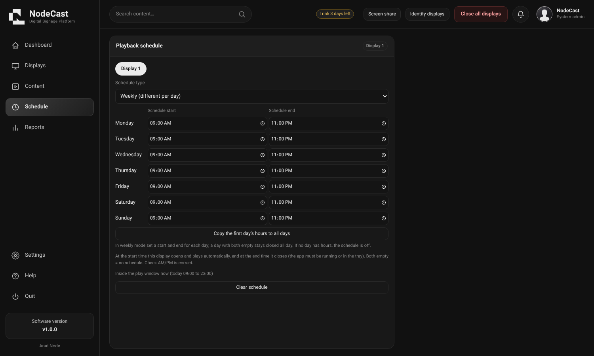
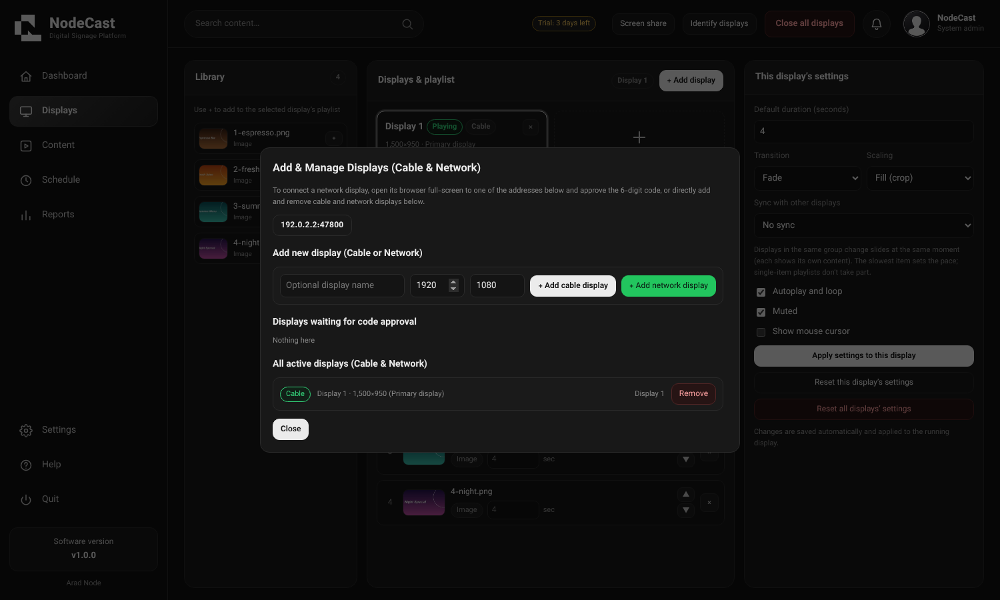

<h1 align="center">NodeCast</h1>

<b>Digital signage for Windows, built for cafés, restaurants and shops.</b> 
Run a different playlist on every screen from one simple app.

> **Status:** NodeCast is a commercial product in active development. This repository is a public showcase (screenshots and feature overview). The source code is private.

## What it does

- **Cable and online displays together.** Plug in HDMI monitors, or add *network displays*: any smart TV, Android box, stick or PC on your local network just opens a web address full-screen, you approve a 6-digit code, and it behaves exactly like a cable display. No cable to the PC. Up to 6 cable + 8 network displays (14 in total) on the full plan.
- **Live screen share.** Mirror your whole desktop or a single open window live to one display or all of them (60 FPS on cable displays, 25–30 FPS MJPEG to network displays), or save it into the library and playlist like any other item.
- **Every display is independent.** Each screen gets its own playlist, transition, scaling mode and settings.
- **Images, videos and web pages** in one content library; drag items into any monitor's playlist and set per-item duration.
- **Weekly schedule.** Set opening and closing hours for each day; displays start and stop by themselves.
- **Synced monitors.** Group screens so slides change at the same moment.
- **Kiosk-friendly.** Starts with Windows, lives in the tray, keeps the PC awake, and can be protected with a PIN.
- **Dark and light themes**, full **Persian (RTL) and English** interface.
- **Offline licensing** (no account or server needed to run) with a free trial, plus automatic updates.

## Screenshots

| Content library | Weekly schedule |
|---|---|
|  |  |

**Adding online (network) displays**

**Persian / light theme**

## Requirements

Windows 10 or 11, 64-bit. Network displays need to be on the same local network as the PC.

## Get it

Releases and pricing will be announced here. For questions or licences, contact the author through the GitHub profile.

---

## نودکست (فارسی)

نودکست یک نرم‌افزار نمایش محتوای دیجیتال (دیجیتال ساینیج) برای ویندوز است که برای کافه‌ها، رستوران‌ها و فروشگاه‌ها ساخته شده. با یک برنامه روی هر مانیتور یک پلی‌لیست جداگانه پخش کنید.

- نمایشگر کابلی و آنلاین (تحت شبکه) کنار هم: هر تلویزیون هوشمند، باکس اندروید یا کامپیوتر روی شبکهٔ محلی فقط یک آدرس را تمام‌صفحه باز می‌کند، کد ۶ رقمی را تأیید می‌کنید و مثل نمایشگر کابلی کار می‌کند، بدون کابل. تا ۶ کابلی + ۸ آنلاین (جمعاً ۱۴ نمایشگر) در نسخهٔ کامل
- اشتراک زنده صفحه‌نمایش (کل دسکتاپ یا یک پنجره) روی یک یا همهٔ نمایشگرها، یا افزودن آن به کتابخانه و پلی‌لیست
- پلی‌لیست و تنظیمات مستقل برای هر نمایشگر
- تصویر، ویدیو و صفحهٔ وب در یک کتابخانهٔ مشترک
- زمان‌بندی هفتگی: شروع و پایان پخش برای هر روز
- همگام‌سازی مانیتورها برای تغییر هم‌زمان اسلاید
- شروع خودکار با ویندوز، اجرا در سینی سیستم و قفل با رمز
- تم تیره و روشن، رابط فارسی (راست‌به‌چپ) و انگلیسی
- لایسنس آفلاین با نسخهٔ آزمایشی و به‌روزرسانی خودکار

> این مخزن فقط برای معرفی محصول است و کد منبع خصوصی است.

