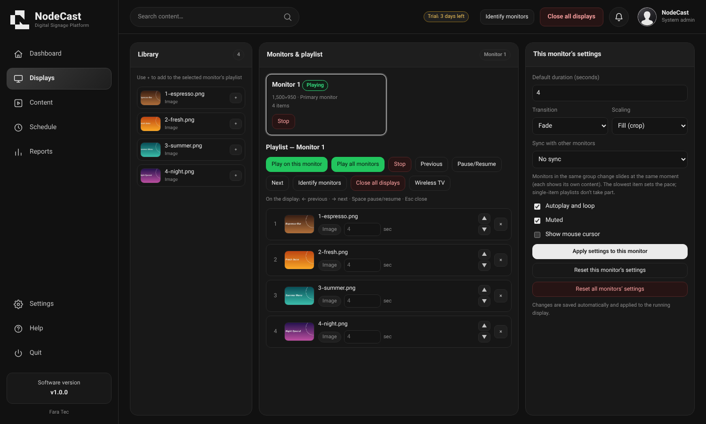
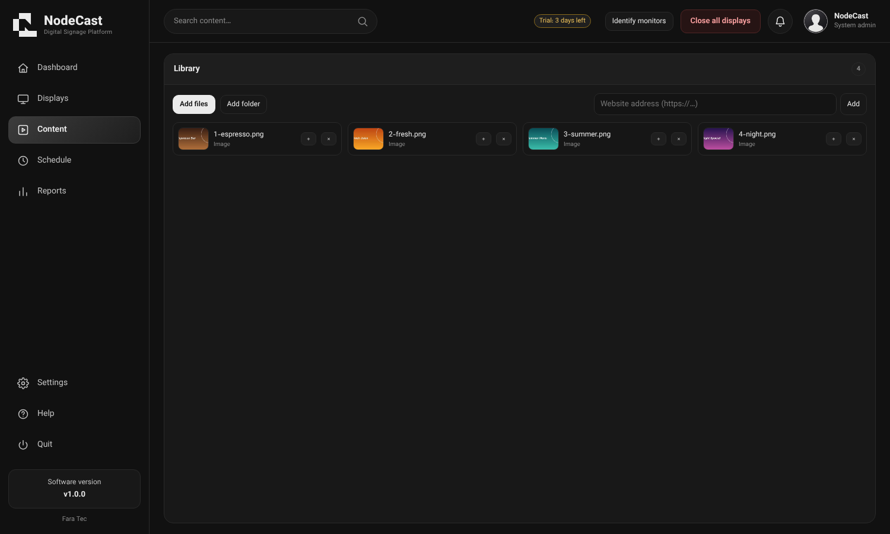
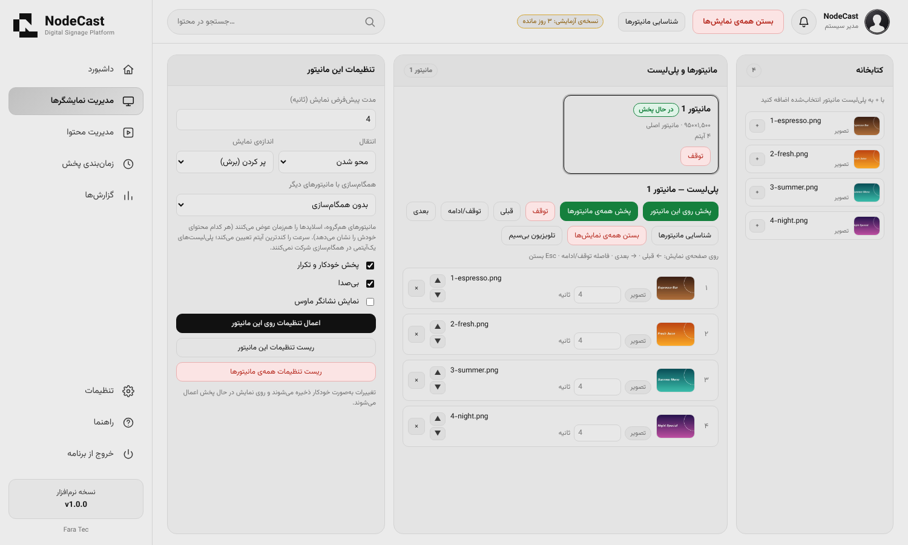

<h1 align="center">NodeCast</h1>

<b>Digital signage for Windows, built for cafés, restaurants and shops.</b> 
Run a different playlist on every screen from one simple app.

> **Status:** NodeCast is a commercial product in active development. This repository is a public showcase (screenshots and feature overview). The source code is private.

## What it does

- **Multiple monitors, one app.** Each connected screen gets its own playlist, transition, scaling mode and settings.
- **Images, videos and web pages** in one content library; drag items into any monitor's playlist and set per-item duration.
- **Weekly schedule.** Set opening and closing hours for each day; displays start and stop by themselves.
- **Synced monitors.** Group screens so slides change at the same moment.
- **Wireless TVs.** Pair a TV or any device with a browser over your local network using a 6-digit code, with no cable to the PC.
- **Kiosk-friendly.** Starts with Windows, lives in the tray, keeps the PC awake, and can be protected with a PIN.
- **Dark and light themes**, full **Persian (RTL) and English** interface.
- **Offline licensing** (no account or server needed to run) with a free trial, plus automatic updates.

## Screenshots

| Content library | Weekly schedule |
|---|---|
|  |  |

**Persian / light theme**

## Requirements

Windows 10 or 11, 64-bit. Wireless TVs need to be on the same local network as the PC.

## Get it

Releases and pricing will be announced here. For questions or licences, contact the author through the GitHub profile.

---

## نودکست (فارسی)

نودکست یک نرم‌افزار نمایش محتوای دیجیتال (دیجیتال ساینیج) برای ویندوز است که برای کافه‌ها، رستوران‌ها و فروشگاه‌ها ساخته شده. با یک برنامه روی هر مانیتور یک پلی‌لیست جداگانه پخش کنید.

- مدیریت چند مانیتور، با پلی‌لیست و تنظیمات مستقل برای هر کدام
- تصویر، ویدیو و صفحهٔ وب در یک کتابخانهٔ مشترک
- زمان‌بندی هفتگی: شروع و پایان پخش برای هر روز
- همگام‌سازی مانیتورها برای تغییر هم‌زمان اسلاید
- تلویزیون بی‌سیم روی شبکهٔ محلی، با کد ۶ رقمی و بدون کابل
- شروع خودکار با ویندوز، اجرا در سینی سیستم و قفل با رمز
- تم تیره و روشن، رابط فارسی (راست‌به‌چپ) و انگلیسی
- لایسنس آفلاین با نسخهٔ آزمایشی و به‌روزرسانی خودکار

> این مخزن فقط برای معرفی محصول است و کد منبع خصوصی است.

